ABSTRACT:: Electric-vehicle battery management systems rarely observe a complete charge–discharge cycle, but they observe many partial charging sessions that start and stop at arbitrary states of charge. This paper asks how accurately, and with what calibrated uncertainty, the state of health (SOH) can be estimated from a single such session when evaluation is separated by cell and by dataset. We construct 81,073 arbitrary partial sessions from 361 cells of six public datasets (CALCE, Sandia, HUST, MATR, NASA and Oxford; LFP, NMC, NCA, LCO and LCO/NCO). Sessions are represented only by quantities a battery management system can measure, terminal voltage and the charge accumulated since plug-in, so the cell capacity cannot leak into the input. We compare ridge regression and gradient-boosted trees on handcrafted session features with a dual-view convolutional encoder trained from scratch and after self-supervised masked-curve pre-training, and we calibrate 90 % prediction intervals with split conformalized quantile regression (CQR). On unseen cells (three seeds), gradient-boosted trees achieved the lowest error, 4.89 ± 0.19 % SOH RMSE (R² = 0.79), while the convolutional encoders reached 5.78–5.81 %; self-supervised pre-training changed RMSE by −0.08 to +0.13 percentage points across seeds and label budgets, which is within seed variability. CQR delivered 0.895 marginal coverage at the 90 % level, but coverage ranged from 0.81 to 0.91 across datasets. When an entire dataset was held out, no model generalized ($R^2\le0$ in all nine model–dataset pairs) and coverage fell to as low as {{xd_min_cov}}. These results indicate that arbitrary partial sessions support coarse SOH estimates with honest, but wide, intervals, and that marginal conformal guarantees do not transfer across datasets without recalibration.

KEYWORDS:: Conformal prediction, electric vehicles, lithium-ion battery, partial charging, self-supervised learning, state of health, uncertainty quantification.

# I. Introduction

The traction battery is the most expensive and least observable component of an electric vehicle (EV). Its state of health (SOH), the currently deliverable discharge capacity divided by the rated capacity, determines driving range, resale value and warranty decisions. A capacity test measures SOH directly, but it requires a full, controlled cycle that a vehicle in daily use rarely performs. What a battery management system (BMS) does observe frequently is a *partial* charging session: the driver plugs in at an arbitrary state of charge (SOC), unplugs at another, and the BMS records the terminal voltage and the charge accumulated in between.

Partial data carry degradation information. Chinomona *et al.* [1] estimated capacity from fixed partial voltage windows of four NASA cells and found that a partial-charge window (3.8–4.1 V) gave a larger error (RMSE 0.13054 Ah) than a partial-discharge window (4.0–3.1 V, RMSE 0.06448 Ah). Wang *et al.* [7] derived an indirect health indicator from the constant-current charging stage, and Tian *et al.* [13] reconstructed charging curves from 30 points collected within 10 min. Three issues that matter for field use remain under-tested in this line of work: sessions that start and stop at arbitrary points; generalization to unseen cells and unseen datasets, since five of the seven audited studies in Section II evaluate on the same four NASA cells; and uncertainty estimates whose coverage is measured on held-out cells rather than assumed.

This paper addresses the following question. *How accurately, and with what calibrated uncertainty, can SOH be estimated from one partial charging session of arbitrary start and length under cell- and dataset-separated evaluation, and does self-supervised pre-training on unlabelled sessions help?* The contributions are:

1. A leakage-controlled benchmark of 81,073 arbitrary partial sessions from 361 cells of six public datasets and five chemistries, in which inputs are restricted to BMS-observable quantities and every evaluation is separated by cell, with a leave-one-dataset-out protocol.
2. A controlled comparison of handcrafted-feature models, raw-curve gradient boosting, and a dual-view convolutional encoder with and without self-supervised masked-curve pre-training, under full and 10 % label budgets. The comparison shows that, in this setting, gradient-boosted trees outperform the learned encoders and that pre-training yields no measurable gain.
3. A measurement of split conformalized quantile regression (CQR) [17] for SOH intervals, showing near-nominal marginal coverage on unseen cells of seen datasets, large per-cell and per-dataset variation, and failure of both accuracy and coverage under dataset shift.

Closely related self-supervised approaches have recently been proposed [19]–[21], including treating partial charging as natural masking [20]; we therefore evaluate self-supervision as a design choice rather than claim it as new. Physics-constrained long-horizon forecasting [18] and downstream services are outside the evaluated scope. The work is part of the battery-health module of SmartEV, an EV charging and route-planning platform (Fig. 1), but all results reported here are offline evaluations. The evaluated pipeline is summarized in Fig. 2.

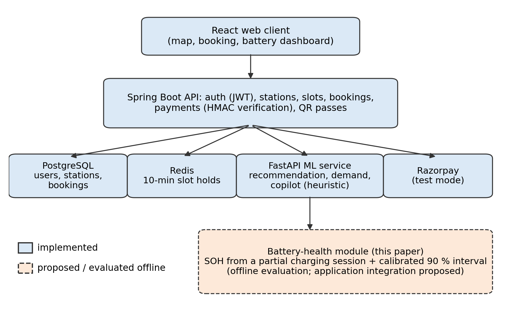{#fig:system}

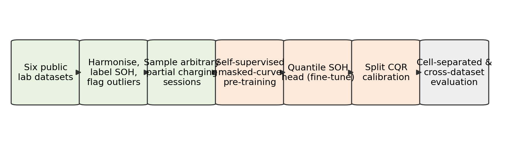{#fig:framework}

# II. Related Work

Table I summarizes the studies whose bibliographic data and key results were verified for this paper. Metrics are quoted as reported; because targets (capacity in Ah, SOH, normalized health indicators, RUL in cycles), datasets and protocols differ, they are not comparable with each other or with our results.

TABLE:: Verified Literature Comparison (Metrics as Reported by the Authors)

| Ref. | Dataset (cells) | Target | Method | Reported result | Limitation for this study |
|---|---|---|---|---|---|
| [1] | NASA B5, B6, B7, B18 | Capacity, RUL | Feature selection + LSTM | Partial charge 3.8–4.1 V: RMSE 0.13054 Ah | Fixed windows tuned on one cell; no intervals |
| [2] | MIT-Stanford (124), Tongji (57) | Early RUL | Lebesgue sampling + parallel-state LSTM | APE 3.59 % / 6.71 % at cycle 100 | Needs a run-to-failure library; no intervals |
| [3] | NASA (6), CALCE CS2 | Capacity, RUL | LSTM + GPR | Capacity RMSE 0.0032 | Full capacity series; Gaussian residuals |
| [4] | NASA random walk + B5–B18 | RUL | DGWO-ELM | Relative RUL error < 3.2 %* | CC-CV charging; no intervals |
| [5] | NASA B5, B6, B7, B18 | Capacity, RUL | Multi-scale CNN + attention LSTM + MC dropout | Capacity RMSE 0.0045–0.0112 | Four cells; dropout intervals uncalibrated |
| [6] | NASA B5, B6, B7, B18 | SOH, RUL | Entropy-graph GCN + LSTM + attention | Mean SOH RMSE 0.0154* | Four cells, one chemistry |
| [7] | NASA B5, B6, B7, B18 | Health indicator, RUL | LTSA indicator + self-attention LSTM | HI RMSE 0.020–0.024 | Needs a full CC charging stage |
| [8] | MIT-Stanford (124 LFP) | Cycle life | ΔQ(V) features + elastic net | — | Full early-life cycles |
| [20] | — (preprint) | SOH | Partial charging as natural masking (SSL) | — | Closest prior idea |
| [22] | — (preprint) | SOH forecast | Conformalized transfer learning | — | Forecasting, not single-session estimation |

\* Taken from the supplied audited survey; not re-verified against the full text.

**Partial-data estimation.** Fixed windows [1], constant-current-stage indicators [7], short fixed-start segments [13] and post-charge voltage relaxation [14] reduce the data needed per estimate, but none of these evaluates sessions with arbitrary start and length across several chemistries. Roman *et al.* [12] proposed a multi-dataset machine-learning pipeline for SOH from charging features, and Lu *et al.* [15] transferred from physics-generated data.

**Uncertainty.** Where uncertainty is provided, it comes from Gaussian process regression [3] or Monte Carlo dropout [5]; neither offers finite-sample coverage, and coverage on unseen cells is rarely reported. Conformal prediction [17] guarantees marginal coverage under exchangeability and has begun to appear for SOH forecasting [22].

**Benchmarks and self-supervision.** BatteryML [23] and BatteryLife [24] standardize larger collections of cells. Masked reconstruction is a widely used self-supervised objective [16], and battery-specific self-supervision with weak labels [19], degradation-aligned objectives [21] and partial-charging masking [20] has been proposed.

The open questions tested here are therefore (i) accuracy under arbitrary BMS-observable sessions across chemistries, (ii) generalization to unseen cells and datasets, (iii) measured coverage of distribution-free intervals, and (iv) whether masked-curve pre-training helps in this multi-source setting. We state three hypotheses: **H1**, a learned encoder outperforms handcrafted-feature baselines on unseen cells; **H2**, self-supervised pre-training helps most when only 10 % of training cells are labelled; **H3**, CQR attains approximately 90 % coverage on unseen cells of seen datasets but not necessarily on an unseen dataset.

# III. Problem Formulation and Data

## A. Definitions

For cell $c$ and cycle $n$, let $Q^{\mathrm{dis}}_{c,n}$ (Ah) be the measured discharge capacity and $Q^{\mathrm{rated}}_c$ (Ah) the rated capacity. Then

$$\mathrm{SOH}_{c,n}=Q^{\mathrm{dis}}_{c,n}/Q^{\mathrm{rated}}_c . \tag{1}$$

SOH is dimensionless; errors are reported in percentage points of SOH (% SOH). Remaining useful life is not a target in this paper.

A session starts at an unobserved fraction $s$ of the full charge and ends at $e=s+w$. The BMS observes the terminal voltage $V(t)$ and the accumulated charge

$$\Delta Q(t)=\int_{t_0}^{t} I(\tau)\,d\tau , \tag{2}$$

where $I$ is the charging current (A) and $t_0$ the plug-in time. The task is

$$\big(\hat{y},\hat{\ell},\hat{u}\big)=f_\theta\big(\{(V_k,\Delta Q_k)\}_{k\in\mathcal{S}},\mathbf{u}\big),\qquad y=\mathrm{SOH}_{c,n}, \tag{3}$$

where $\mathcal{S}$ indexes the samples inside the session, $\mathbf{u}$ is BMS-available context (chemistry, ambient temperature, charging C-rate), and $[\hat{\ell},\hat{u}]$ should contain $y$ with probability at least $1-\alpha$, with $\alpha=0.1$. Table II lists the notation.

TABLE:: Notation

| Symbol | Meaning | Unit |
|---|---|---|
| $Q^{\mathrm{dis}}_{c,n}$, $Q^{\mathrm{rated}}_c$ | Measured discharge capacity; rated capacity | Ah |
| $s$, $w$ | Session start and width as fractions of the full charge (not observed) | — |
| $\Delta Q$ | Charge accumulated since session start | Ah |
| $\mathbf{x}^{a}$, $\mathbf{x}^{v}$ | Charge-domain and voltage-domain session views | — |
| $\mathbf{u}$ | Context: chemistry, ambient temperature, C-rate | — |
| $\hat{q}_\tau$ | Predicted $\tau$-quantile of SOH | — |
| $E_i$, $\hat{Q}$ | Conformity score; conformal correction | SOH |

## B. Datasets

Six public datasets were harmonized into one schema (Table III, Fig. 3): CALCE [10], Sandia/SNL [25], HUST [26], MATR [8], [27], NASA PCoE [9] and Oxford [11]. CALCE, SNL, HUST and MATR were taken from the processed BatteryLife release [24]; NASA and Oxford from the original files. All signals were converted to SI units with charge current positive, Oxford timestamps (stored in days) were converted to seconds, and the duplicated NASA cells B0025–B0028 were included once. This gave 362 cells and 400,224 cycles. Outlier cycles were flagged per cell with a Hampel filter on SOH (window 21, threshold three scaled median absolute deviations, MAD floored at 0.5 % SOH), which removed 0.29 % of cycles, including 11.7 % of NASA cycles, consistent with NASA's note on anomalous low-capacity runs. One NASA cell without a valid charge curve was excluded, leaving 361 cells. SmartEV also holds vehicle trip-energy data (VED [28]), which is not used here because it contains no battery-health labels.

TABLE:: Datasets Used (Statistics Computed From the Processed Files)

| Source | Cells | Chemistry | Rated (Ah) | Ambient (°C) | Max charge C-rate | Sessions | SOH range |
|---|---|---|---|---|---|---|---|
| CALCE [10] | 13 | LCO | 1.1–1.35 | 25 | 0.5 | 3,118 | 0.50–1.05 |
| SNL [25] | 61 | LFP 18, NMC 21, NCA 22 | 1.1 / 3.0 / 3.2 | 15, 25, 35 | 0.5 | 14,640 | 0.50–1.01 |
| HUST [26] | 77 | LFP | 1.1 | 30 | 5 | 18,480 | 0.81–1.14 |
| MATR [8], [27] | 169 | LFP | 1.1 | 30 | 8 | 40,224 | 0.50–1.00 |
| NASA [9] | 33 | Undisclosed | 2.0 | 4, 24, 43–44 | 0.75 | 3,587 | 0.50–1.02 |
| Oxford [11] | 8 | LCO/NCO | 0.74 | 40 | 2 | 1,024 | 0.74–1.00 |
| Total | 361 | 5 + undisclosed | | | | 81,073 | |

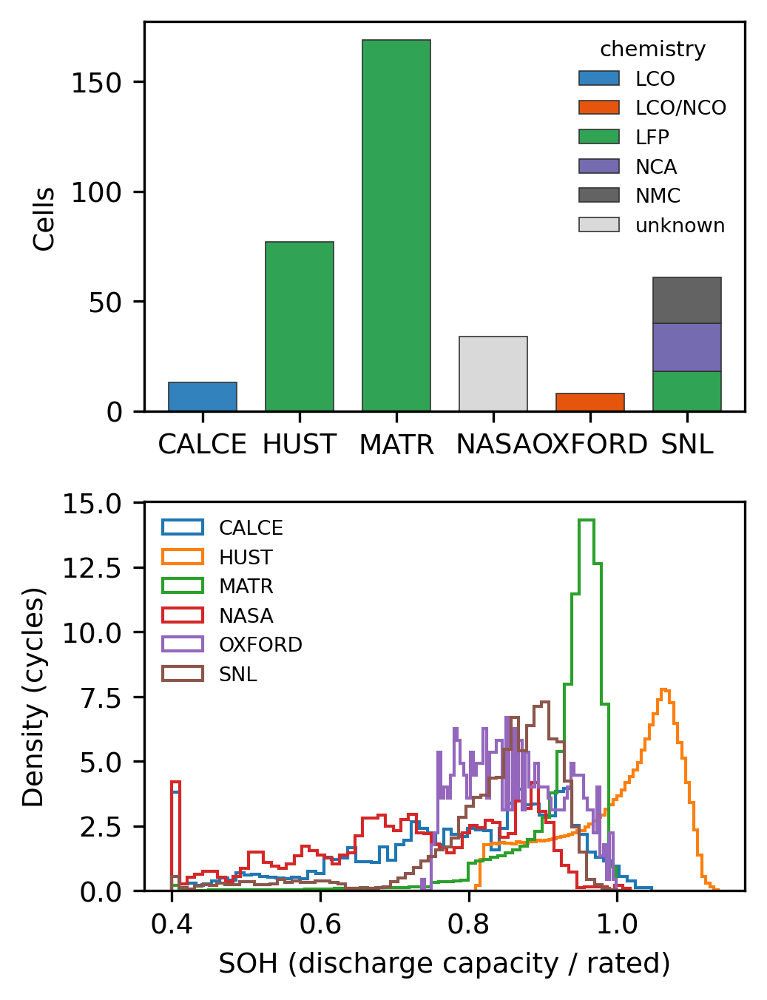{#fig:dataset}

## C. Partial-Session Construction

For each cell, up to 120 clean cycles with $0.5\le\mathrm{SOH}\le1.2$ were selected evenly over life, and two sessions were sampled per cycle with $s\sim\mathcal{U}(0.05,0.60)$ and $w\sim\mathcal{U}(0.15,0.40)$, truncated at $e=0.98$. From the stored charging curve $V(q)$, the accumulated charge in a session is $\Delta Q=(q-s)\,Q^{\mathrm{ch}}_{c,n}$. **The model never receives $s$, $w$, $Q^{\mathrm{ch}}$ or $Q^{\mathrm{dis}}$.** Each session is encoded in two views (Fig. 4): the charge-domain view $\mathbf{x}^{a}\in\mathbb{R}^{2\times48}$, which holds the voltage at fixed accumulated-charge steps $\Delta Q/Q^{\mathrm{rated}}\in[0,0.40]$ with a mask after the session ends; and the voltage-domain view $\mathbf{x}^{v}\in\mathbb{R}^{2\times64}$, which holds the normalized accumulated charge at fixed voltages (LFP 3.20–3.60 V, others 3.50–4.20 V) with a mask outside the observed range. Normalizing by the rated capacity uses only a datasheet value, and because sessions are defined by their observable endpoints, the ratio $\Delta Q/\Delta\mathrm{SOC}$, which would reveal capacity, is not available to the model.

For the baselines, nine handcrafted session features were computed: start and end voltage, voltage span, accumulated charge, charge per volt, the maximum and location of the incremental capacity $d\Delta Q/dV$, the charge at mid-voltage, and the number of observed voltage bins. These were combined with five context variables.

{#fig:curves}

# IV. Methods

## A. Baselines

We use three baselines: ridge regression on standardized handcrafted features and context; LightGBM [29] on the same features; and LightGBM on the features plus the flattened two views (238 inputs). The choice between feature sets was made on a validation split of training cells only, so test cells were never used for model selection.

## B. Dual-View Convolutional Encoder

Each view receives a third channel, a hidden-position flag that is zero during fine-tuning, and is processed by its own encoder: three 1-D convolutions with kernel 5, dilations 1, 2 and 4, 48 channels, batch normalization, GELU activation and residual connections (Fig. 5). Masked mean and max pooling over observed positions give 96 features per view, which are concatenated with $\mathbf{u}$ and passed to a multilayer perceptron (128 units, dropout 0.1) with three outputs $(a,m,b)$. Quantile ordering is enforced by construction,

$$\hat{q}_{0.05}=m-\operatorname{softplus}(a),\quad \hat{q}_{0.5}=m,\quad \hat{q}_{0.95}=m+\operatorname{softplus}(b), \tag{4}$$

and training minimizes the summed pinball loss

$$\mathcal{L}_{\mathrm{sup}}=\sum_{\tau\in\{0.05,0.5,0.95\}}\frac{1}{N}\sum_{i=1}^{N}\rho_\tau\big(y_i-\hat{q}_{\tau,i}\big),\quad \rho_\tau(r)=\max\{\tau r,(\tau-1)r\}. \tag{5}$$

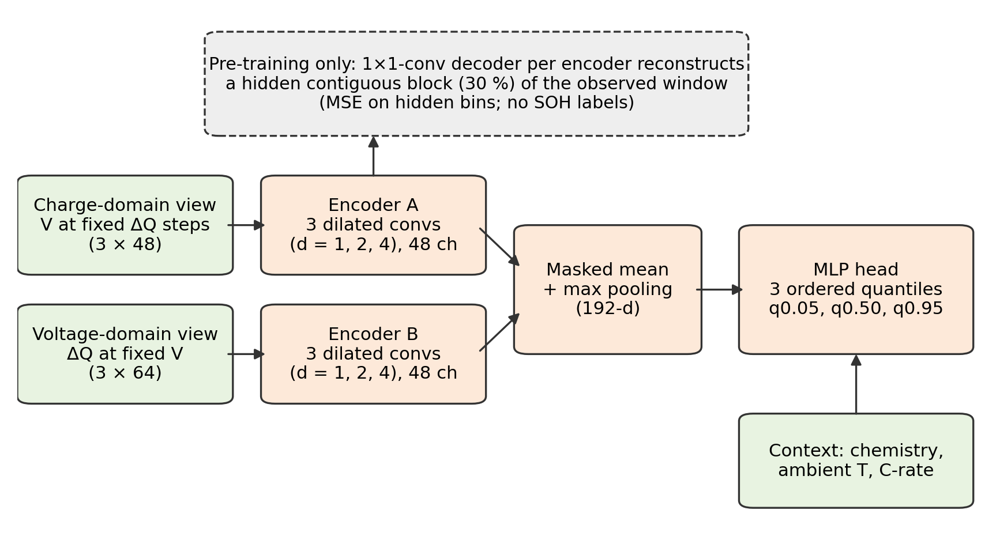{#fig:model}

## C. Self-Supervised Masked-Curve Pre-Training

Before fine-tuning, both encoders are pre-trained on all training-cell sessions without SOH labels. In each session, one contiguous block covering 30 % of the observed positions is hidden: its value and mask are set to zero and its flag to one. A 1×1-convolution decoder then reconstructs the hidden standardized values:

$$\mathcal{L}_{\mathrm{ssl}}=\sum_{v\in\{a,v\}}\frac{1}{|\mathcal{H}_v|}\sum_{k\in\mathcal{H}_v}\big(\hat{x}^{v}_{k}-x^{v}_{k}\big)^2 , \tag{6}$$

where $\mathcal{H}_v$ is the set of hidden positions. The pre-trained weights initialize the supervised model, which is then fine-tuned end-to-end with (5).

## D. Split Conformalized Quantile Regression

Quantile models (the CNNs, and LightGBM with quantile objectives at $\tau=0.05$ and $0.95$) are fitted on training cells. On disjoint calibration cells $\mathcal{C}$, we compute [17]

$$E_i=\max\{\hat{q}_{0.05}(x_i)-y_i,\;y_i-\hat{q}_{0.95}(x_i)\},\quad i\in\mathcal{C}, \tag{7}$$

and form the test interval

$$\big[\hat{q}_{0.05}(x)-\hat{Q},\;\hat{q}_{0.95}(x)+\hat{Q}\big], \tag{8}$$

where $\hat{Q}$ is the $\lceil(|\mathcal{C}|+1)(1-\alpha)\rceil$-th smallest $E_i$. Coverage of (8) is guaranteed only under exchangeability of calibration and test samples. Sessions from one cell are dependent, and sessions from an unseen dataset are not exchangeable with the calibration set, so coverage is measured rather than assumed.

ALGORITHM:: Training and evaluation for one split
Input: sessions with cell identifiers; seed r; label fraction f; model M
1. Split cells, stratified by source, into test (20 %); then calibration (15 %), validation (15 %) and training cells.
2. Fit all scalers on training cells only.
3. If M is the self-supervised CNN, pre-train both encoders on all training-cell sessions with (6).
4. Label a random fraction f of the training cells (f = 1 or 0.1).
5. Fit M on the labelled cells, with early stopping on validation cells.
6. Predict quantiles on calibration cells and compute the correction Q from (7)–(8).
7. Predict the test cells once; report RMSE, MAE, R², coverage and interval width.

# V. Experimental Setup

Table IV lists the configuration, and Fig. 6 shows the partitioning and leakage controls. With all labels, 201 training cells were used on average; with 10 % labels, 20. Each test set contained 75 cells and 16,686 sessions per seed. RMSE and MAE are reported in % SOH; coverage is the fraction of test sessions whose true SOH lies inside the interval, and width is the mean interval length in % SOH.

TABLE:: Experimental Configuration

| Item | Setting |
|---|---|
| Splits | Cell-level, stratified by source: test 20 %; calibration 15 %, validation 15 %, train rest; seeds 0, 1, 2 |
| Label budgets | 100 % and 10 % of training cells (pre-training always uses all training-cell sessions, unlabelled) |
| Cross-dataset | Leave-one-source-out for MATR, HUST and SNL (seed 0, all labels) |
| Sessions | $s\sim\mathcal{U}(0.05,0.60)$, $w\sim\mathcal{U}(0.15,0.40)$; 2 per cycle; at most 120 cycles per cell |
| CNN | AdamW, learning rate 2×10⁻³, weight decay 10⁻⁴, cosine schedule, batch 512, at most 25 epochs, patience 5 |
| Pre-training | 10 epochs; contiguous 30 % mask; MSE on hidden positions |
| LightGBM | Up to 2000 trees, learning rate 0.03, 31 leaves, 40 samples per leaf, 0.8 row and column subsampling, early stopping after 100 rounds |
| Intervals | α = 0.1 (90 % nominal), split CQR on calibration cells |
| Software | Python 3.13, PyTorch 2.11 (CPU), LightGBM 4.6, scikit-learn 1.7 |

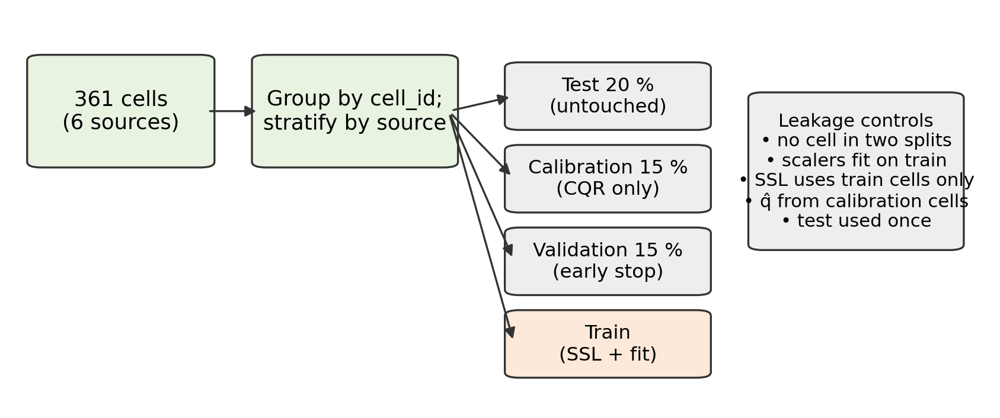{#fig:workflow}

# VI. Results and Discussion

## A. Accuracy on Unseen Cells

Table V reports test results averaged over three seeds, and Fig. 7 compares the models. With all labels, LightGBM on handcrafted features plus raw views achieved the lowest error, 4.89 ± 0.19 % SOH RMSE (MAE 3.37 %, R² = 0.793), closely followed by LightGBM on handcrafted features alone (4.94 ± 0.14 %). Both convolutional encoders were about 0.9 percentage points worse: supervised, 5.81 ± 0.28 %; self-supervised, 5.78 ± 0.26 %. The gap was consistent within every seed (0.81, 0.94 and 0.92 points). Ridge regression reached 7.46 ± 0.41 %. **H1 is therefore not supported**: in this setting, a compact set of physically motivated session features with gradient boosting is a stronger estimator than the learned encoder. One caveat is that the encoders' validation error was still decreasing at the 25-epoch limit (Fig. 8), so a longer training budget could narrow the gap. Fig. 9 shows predicted against measured SOH for the best model.

TABLE:: SOH Estimation on Unseen Cells (Mean ± Standard Deviation Over Three Seeds)

{{table_main}}

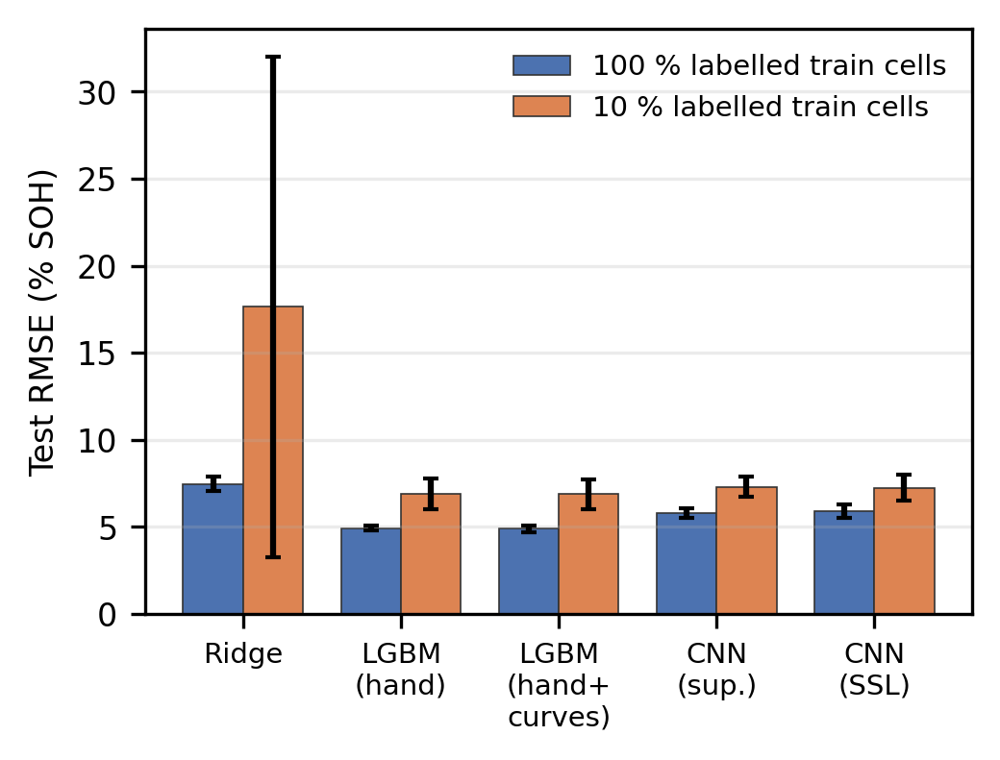{#fig:comparison}

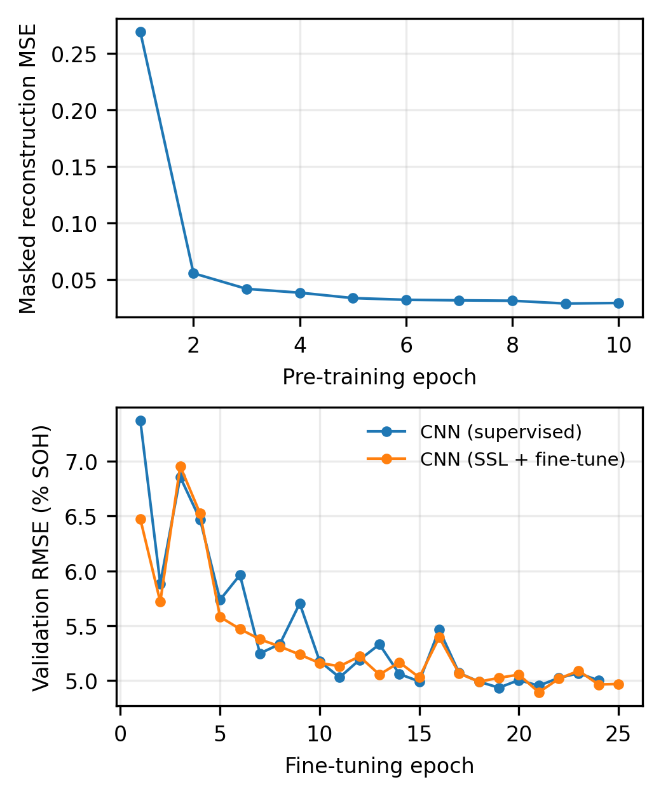{#fig:training}

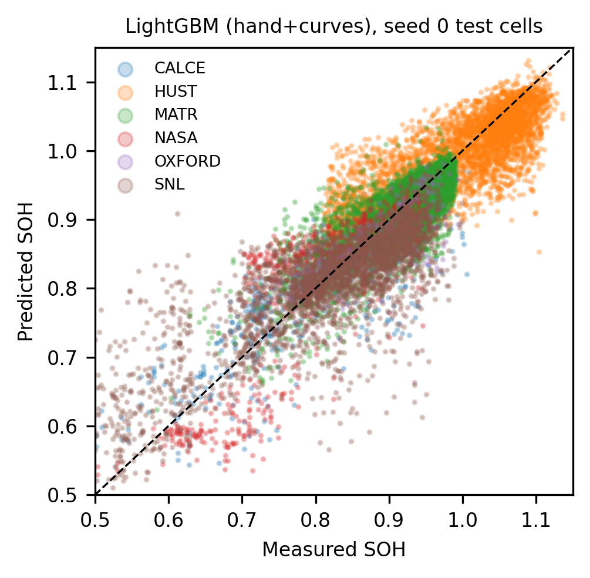{#fig:scatter}

Errors varied strongly by source (Table VI). For the best model they were lowest on MATR (3.10 %) and Oxford (3.72 %), and highest on NASA (7.59 %) and SNL (6.56 %). These two sources combine the smallest cell counts per condition with the widest range of temperatures, chemistries or protocols.

TABLE:: Test RMSE (% SOH) by Source (Mean Over Three Seeds)

{{table_source}}

## B. Effect of Self-Supervised Pre-Training and Label Scarcity

Pre-training changed RMSE relative to the supervised encoder by −0.01, −0.01 and −0.08 points with all labels, and by +0.09, −0.35 and +0.13 points with 10 % labels, across seeds 0–2. The average change (−0.03 and −0.04 points) is far smaller than the seed-to-seed standard deviation (0.26 and 0.77 points). **H2 is therefore not supported** at this scale: masked reconstruction of 30 % of an observed session did not yield representations that improved SOH estimation, even when labels were scarce. With 10 % labels (about 20 training cells), every model degraded: LightGBM reached 6.89 ± 0.84 %, the encoders 7.26–7.30 %. Ridge regression was unstable (17.64 ± 14.38 %; 34.21 % on seed 2), consistent with extrapolation from very few cells.

## C. Sensitivity to Session Start and Width

Fig. 10 shows test RMSE as a function of the session parameters, which are hidden from the models. For LightGBM on handcrafted features, error decreased from 5.24 % for the shortest sessions (15–20 % of a full charge) to 4.45 % for the longest (35–40 %). Error was highest for sessions starting near empty (5.18 % for $s\le0.15$) and lowest for starts at 35–45 % of the charge (4.56 %). The encoders followed the same trends at a higher level. Longer sessions that cover the mid-SOC region are therefore the most informative, which is consistent with degradation signatures concentrated in the voltage plateaus.

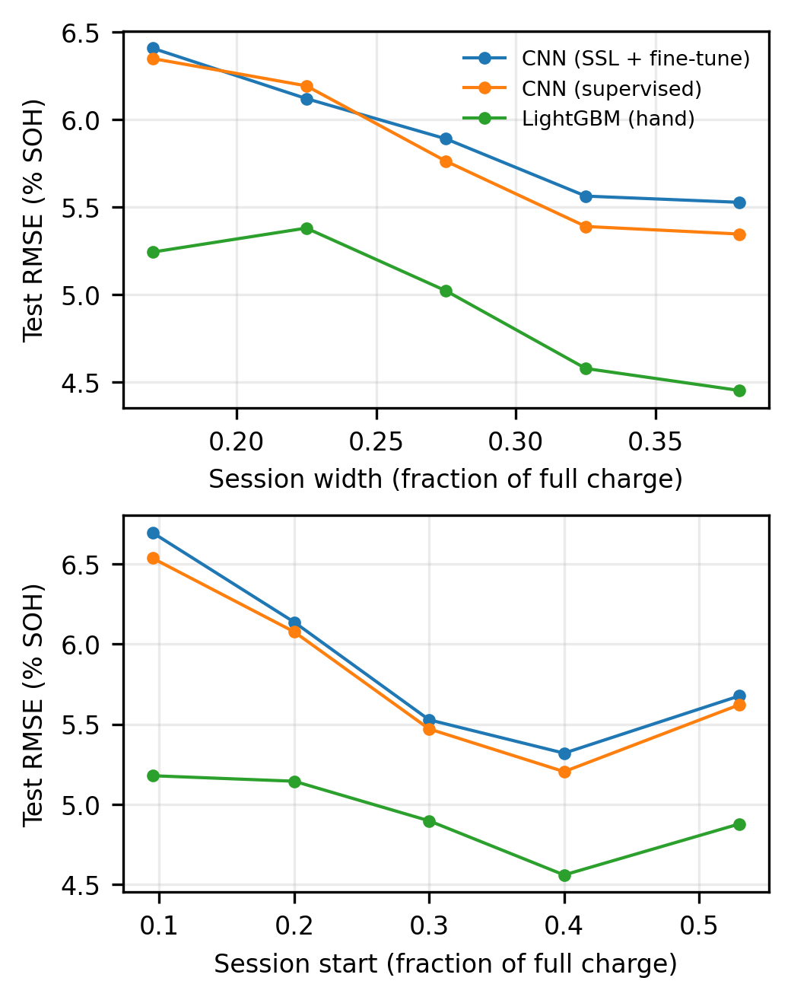{#fig:window}

## D. Calibration of Prediction Intervals

With all labels, split CQR produced a marginal coverage of 0.895 with a mean width of 14.1 % SOH for LightGBM, and 0.893 with 17.1 % for the self-supervised encoder; with 10 % labels, coverage was 0.883–0.888. The conformal correction acted in opposite directions for the two model families. It widened the LightGBM quantile intervals by 0.74 points on average, because the raw quantiles under-covered, and narrowed the CNN intervals by 0.93 points, because the raw quantiles over-covered. Marginal coverage did not hold uniformly, however (Fig. 11). Per-source coverage of the best model ranged from 0.808 (NASA) to 0.914 (MATR), and per-cell coverage had a median of 0.921 but a minimum of 0.099. **H3 is partly supported**: CQR is approximately calibrated *on average* over unseen cells, but it provides no per-battery guarantee. An interval about 14 points wide is also too wide for warranty-grade decisions, although it suffices for coarse health categories.

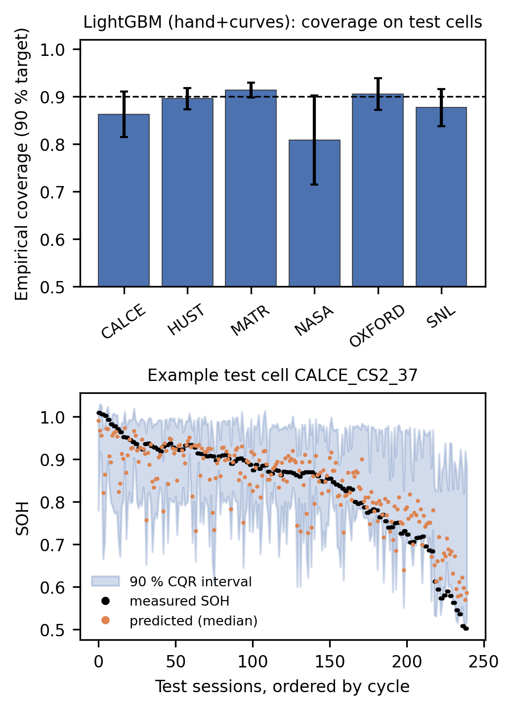{#fig:calibration}

## E. Generalization to an Unseen Dataset

When an entire source was held out (Table VII, Fig. 12), every model failed to generalize. RMSE rose to 6.44–7.65 % (MATR held out), 7.94–8.49 % (HUST) and 10.92–12.18 % (SNL), and $R^2$ was at or below zero in all nine cases; that is, no model predicted SOH of an unseen dataset better than that dataset's own mean. Coverage collapsed where the held-out SOH distribution differed most from the training sources. For HUST, whose cells have SOH up to 1.14 (above rated capacity), coverage fell to 0.21–0.32; for SNL, with its three chemistries and DoD windows, it fell to 0.61–0.65; for MATR it remained 0.83–0.95. Self-supervised pre-training gave the lowest error on held-out MATR (6.44 % vs. 7.51 % for LightGBM and 7.65 % for the supervised encoder) but not on HUST (8.06 % vs. 7.94 %) or SNL (12.18 % vs. 10.92 %), so it is not a consistent remedy for dataset shift. Because the calibration cells come from the training sources, the exchangeability assumption behind (8) is violated, and the measured coverage shows its practical consequence: a deployment on a new vehicle platform needs labelled calibration data, and likely training data, from that platform.

TABLE:: Leave-One-Dataset-Out Results (Seed 0, All Labels)

{{table_xdata}}

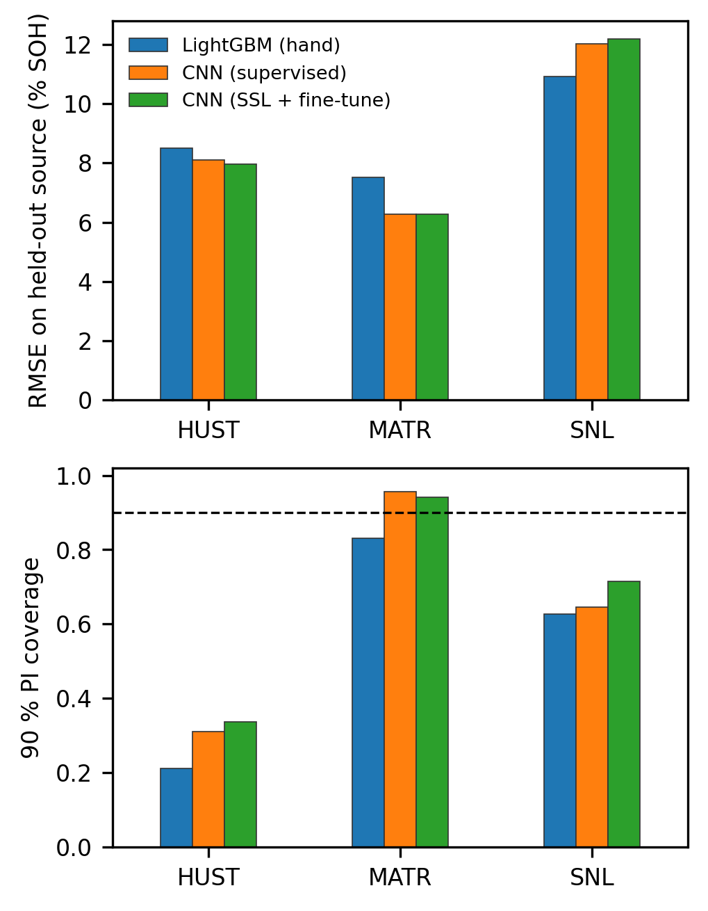{#fig:xdata}

## F. Computational Cost

On a 24-core CPU with 16 threads, training one LightGBM configuration (three quantile models) took 24–40 s, and training one encoder took about 6 min, plus pre-training. Inference latency was not measured and is not reported.

# VII. Integration Into SmartEV

SmartEV (Fig. 1) provides charging-station discovery, slot reservation with Redis-based holds, server-verified payments, route planning and a battery dashboard. Its FastAPI service currently hosts heuristic recommendation and demand modules. The estimator studied here has been evaluated offline only. A prototype integration would receive each completed session (voltage and accumulated charge, chemistry, ambient temperature, C-rate) and return the median SOH and its 90 % interval. It would smooth successive estimates per vehicle, show range information with its uncertainty, and use the interval width to decide between an informational message ("estimate improving") and an alert. Given the coverage loss under dataset shift (Section VI-E), recalibration on field data and continuous coverage monitoring would be prerequisites. The estimator does not guarantee battery safety or optimize charging.

# VIII. Limitations and Threats to Validity

Table VIII summarizes the main threats to validity and their implications for deployment.

TABLE:: Limitations and Deployment Implications

| Limitation | Effect | Addressed here |
|---|---|---|
| Laboratory cells (0.74–3.2 Ah), controlled protocols | No pack effects, cell imbalance or BMS current/SOC errors | No; requires fleet data |
| Sessions cropped from measured full charges | Real sessions include rest, temperature and current transients | Partly (random start and width) |
| LFP dominates (264 of 361 cells) | Aggregate metrics weighted towards LFP | Per-source results reported |
| Dependent sessions within a cell | CQR exchangeability holds only approximately | Coverage measured per source and cell |
| Dataset shift | Coverage falls on an unseen dataset | Measured (leave-one-dataset-out) |
| Encoder training budget (25 epochs, CPU) | Encoders may be under-trained | Disclosed (Fig. 8) |
| Three seeds; limited hyperparameter search | Coarse variance estimates; results are not an upper bound | Disclosed |
| No field SOH labels | Field accuracy unknown | No |

# IX. Conclusion

From one arbitrary partial charging session, represented only by BMS-observable voltage and accumulated charge, SOH could be estimated on unseen laboratory cells with 4.89 ± 0.19 % RMSE by gradient-boosted trees on physically motivated session features. A dual-view convolutional encoder was about 0.9 points worse, and self-supervised masked-curve pre-training did not change its accuracy measurably, even with 10 % labels. Longer sessions that cover the mid-SOC region were the most informative. Split CQR gave near-nominal marginal coverage (0.895) on unseen cells of seen datasets, but coverage varied widely between datasets and individual cells. When a whole dataset was held out, no model generalized ($R^2\le0$) and coverage fell to 0.21–0.95 depending on the dataset. These are negative or qualified findings for H1–H3, and they suggest two priorities. First, partial-session SOH estimators should be benchmarked with cell- and dataset-separated protocols against strong feature-based baselines. Second, interval methods for dependent, shifted battery data, such as group- or domain-conditional conformal prediction, need further work. Future work will test longer encoder training and alternative pre-training objectives, physics-constrained degradation forecasting with explicitly enforced monotonicity [18], and field validation with fleet charging sessions.

# References

[1] B. Chinomona, C. Chung, L.-K. Chang, W.-C. Su, and M.-C. Tsai, "Long short-term memory approach to estimate battery remaining useful life using partial data," *IEEE Access*, vol. 8, pp. 165419–165431, 2020, doi: 10.1109/ACCESS.2020.3022505.

[2] G. Lyu, H. Zhang, and Q. Miao, "Parallel state fusion LSTM-based early-cycle stage lithium-ion battery RUL prediction under Lebesgue sampling framework," *Reliab. Eng. Syst. Saf.*, vol. 236, Art. no. 109315, 2023, doi: 10.1016/j.ress.2023.109315.

[3] K. Liu, Y. Shang, Q. Ouyang, and W. D. Widanage, "A data-driven approach with uncertainty quantification for predicting future capacities and remaining useful life of lithium-ion battery," *IEEE Trans. Ind. Electron.*, vol. 68, no. 4, pp. 3170–3180, Apr. 2021, doi: 10.1109/TIE.2020.2973876.

[4] J. Zhu, T. Tan, L. Wu, and H. Yuan, "RUL prediction of lithium-ion battery based on improved DGWO-ELM method in a random discharge rates environment," *IEEE Access*, vol. 7, pp. 125176–125187, 2019, doi: 10.1109/ACCESS.2019.2936822.

[5] Z. Kong, S. Li, and C. Wang, "Estimation and uncertainty quantification of remaining useful life (RUL) of electric vehicle batteries using a temporal deep model," *Sci. Rep.*, vol. 16, Art. no. 18704, 2026, doi: 10.1038/s41598-026-54385-4.

[6] Y. Wei and D. Wu, "Prediction of state of health and remaining useful life of lithium-ion battery using graph convolutional network with dual attention mechanisms," *Reliab. Eng. Syst. Saf.*, vol. 230, Art. no. 108947, 2023, doi: 10.1016/j.ress.2022.108947.

[7] Z. Wang, N. Liu, C. Chen, and Y. Guo, "Adaptive self-attention LSTM for RUL prediction of lithium-ion batteries," *Inf. Sci.*, vol. 635, pp. 398–413, 2023, doi: 10.1016/j.ins.2023.01.100.

[8] K. A. Severson *et al.*, "Data-driven prediction of battery cycle life before capacity degradation," *Nat. Energy*, vol. 4, pp. 383–391, 2019, doi: 10.1038/s41560-019-0356-8.

[9] B. Saha and K. Goebel, "Battery data set," NASA Ames Prognostics Data Repository, NASA Ames Research Center, Moffett Field, CA, USA, 2007.

[10] Y. Xing, E. W. M. Ma, K.-L. Tsui, and M. Pecht, "An ensemble model for predicting the remaining useful performance of lithium-ion batteries," *Microelectron. Reliab.*, vol. 53, no. 6, pp. 811–820, 2013, doi: 10.1016/j.microrel.2012.12.003.

[11] C. R. Birkl, "Diagnosis and prognosis of degradation in lithium-ion batteries," Ph.D. dissertation, Dept. Eng. Sci., Univ. Oxford, Oxford, U.K., 2017.

[12] D. Roman, S. Saxena, V. Robu, M. Pecht, and D. Flynn, "Machine learning pipeline for battery state-of-health estimation," *Nat. Mach. Intell.*, vol. 3, no. 5, pp. 447–456, 2021, doi: 10.1038/s42256-021-00312-3.

[13] J. Tian, R. Xiong, W. Shen, J. Lu, and X.-G. Yang, "Deep neural network battery charging curve prediction using 30 points collected in 10 min," *Joule*, vol. 5, no. 6, pp. 1521–1534, 2021, doi: 10.1016/j.joule.2021.05.012.

[14] J. Zhu *et al.*, "Data-driven capacity estimation of commercial lithium-ion batteries from voltage relaxation," *Nat. Commun.*, vol. 13, Art. no. 2261, 2022, doi: 10.1038/s41467-022-29837-w.

[15] J. Lu, R. Xiong, J. Tian, C. Wang, and F. Sun, "Deep learning to estimate lithium-ion battery state of health without additional degradation experiments," *Nat. Commun.*, vol. 14, Art. no. 2760, 2023, doi: 10.1038/s41467-023-38458-w.

[16] K. He, X. Chen, S. Xie, Y. Li, P. Dollár, and R. Girshick, "Masked autoencoders are scalable vision learners," in *Proc. IEEE/CVF Conf. Comput. Vis. Pattern Recognit.*, 2022, pp. 15979–15988, doi: 10.1109/CVPR52688.2022.01553.

[17] Y. Romano, E. Patterson, and E. J. Candès, "Conformalized quantile regression," in *Proc. Adv. Neural Inf. Process. Syst.*, vol. 32, 2019. [Online]. Available: arXiv:1905.03222.

[18] C. Rackauckas *et al.*, "Universal differential equations for scientific machine learning," 2020, arXiv:2001.04385.

[19] T. Wang, Z. Ma, S. Zou, Z. Chen, and P. Wang, "Lithium-ion battery state-of-health estimation: A self-supervised framework incorporating weak labels," *Appl. Energy*, vol. 355, Art. no. 122332, 2024, doi: 10.1016/j.apenergy.2023.122332.

[20] L. Teng, W. Li, and Z. Li, "Partial charging as natural masking: Self-supervised pre-training for lithium-ion battery state of health prediction," SSRN preprint, 2026, doi: 10.2139/ssrn.7552735.

[21] J. Yao and J. Kowal, "Degradation-aligned self-supervised learning for state of health estimation of lithium-ion batteries under label sparsity," 2026, arXiv:2608.16612.

[22] S. F. da Silva, M. F. Ozkan, F. El Idrissi, and M. Canova, "Conformalized transfer learning for Li-ion battery state of health forecasting under manufacturing and usage variability," 2026, arXiv:2603.24475.

[23] H. Zhang *et al.*, "BatteryML: An open-source platform for machine learning on battery degradation," 2023, arXiv:2310.14714.

[24] R. Tan *et al.*, "BatteryLife: A comprehensive dataset and benchmark for battery life prediction," 2025, arXiv:2502.18807.

[25] Y. Preger *et al.*, "Degradation of commercial lithium-ion cells as a function of chemistry and cycling conditions," *J. Electrochem. Soc.*, vol. 167, no. 12, Art. no. 120532, 2020, doi: 10.1149/1945-7111/abae37.

[26] G. Ma *et al.*, "Real-time personalized health status prediction of lithium-ion batteries using deep transfer learning," *Energy Environ. Sci.*, vol. 15, pp. 4083–4094, 2022, doi: 10.1039/D2EE01676A.

[27] P. M. Attia *et al.*, "Closed-loop optimization of fast-charging protocols for batteries with machine learning," *Nature*, vol. 578, pp. 397–402, 2020, doi: 10.1038/s41586-020-1994-5.

[28] G. S. Oh, D. J. LeBlanc, and H. Peng, "Vehicle energy dataset (VED), a large-scale dataset for vehicle energy consumption research," 2019, arXiv:1905.02081.

[29] G. Ke *et al.*, "LightGBM: A highly efficient gradient boosting decision tree," in *Proc. Adv. Neural Inf. Process. Syst.*, vol. 30, 2017.
